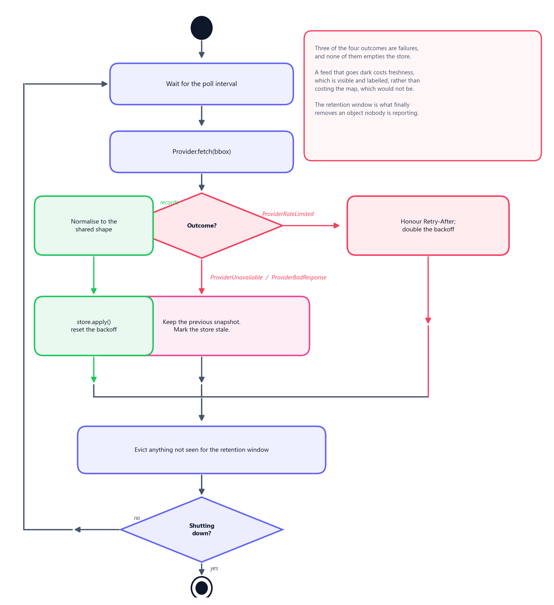

# Appendix C: Activity Diagram

{width=4.9in}

An activity diagram of the happy path would be a straight line and would say
nothing. The branches are the content: **three of the four outcomes of a fetch
are failures**, and what happens to each is the reason the map does not go blank
when a feed does.

| Outcome | Response |
|---|---|
| Records returned | Normalise, apply to the store, reset the backoff |
| `ProviderRateLimited` | Honour `Retry-After`, double the backoff, keep the snapshot |
| `ProviderUnavailable` | Keep the previous snapshot, mark the store stale |
| `ProviderBadResponse` | As above — a malformed answer is treated as no answer |

**None of the three failures empties the store.** A feed that goes dark costs
freshness, which is visible and labelled in the status bar, rather than costing
the map, which would not be. The retention window is what finally removes an
object that nobody is reporting — a decision made by elapsed time, not by one
failed request.
