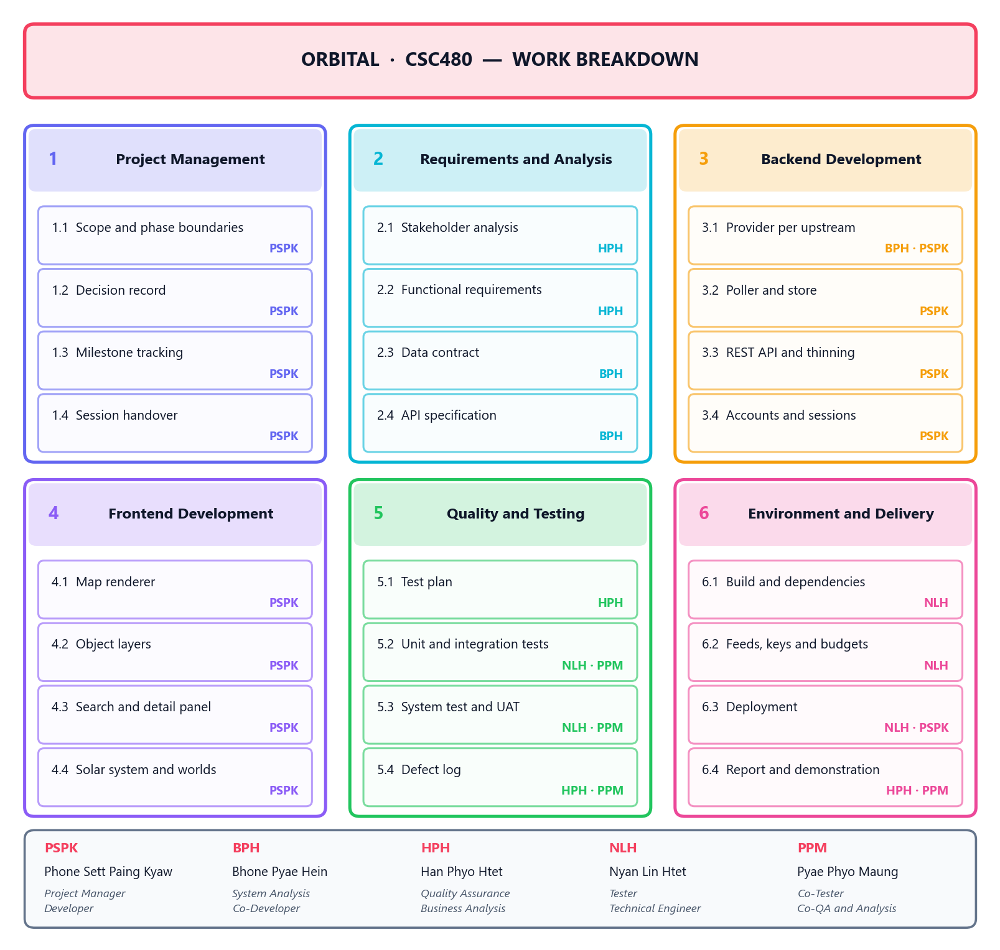
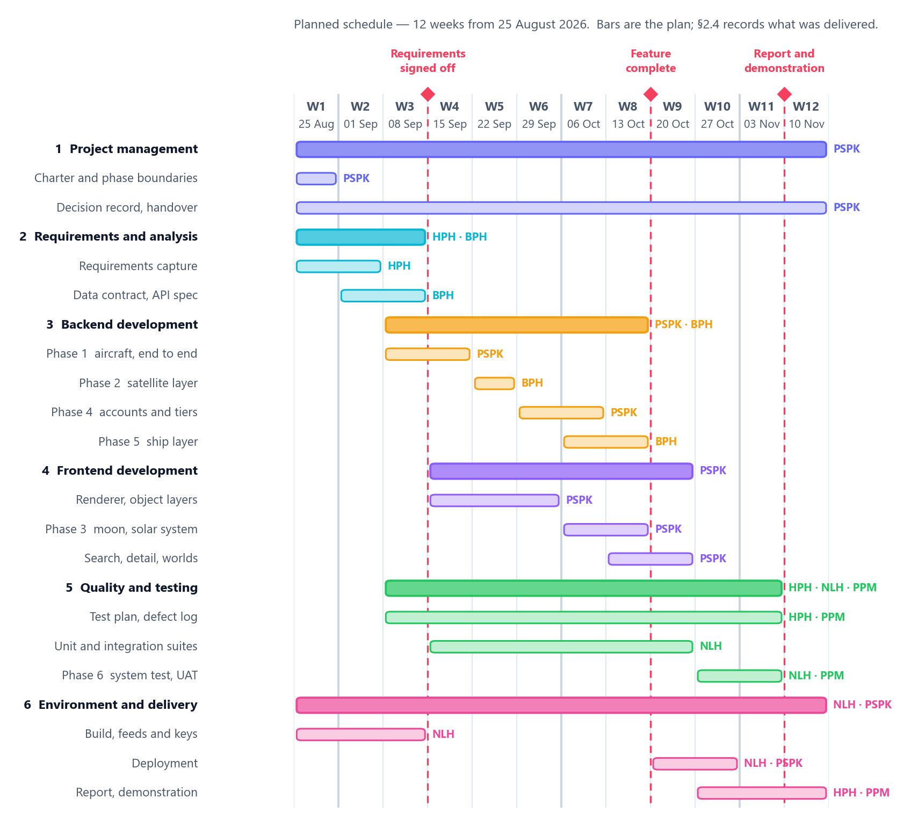

# Chapter 4: Project Methodology

The project was run as a sequence of **incremental phases, each delivering a
working vertical slice**: one kind of object taken all the way from its data
feed to a marker on the deployed map before the next was started. Each phase
ended with a team review that accepted the phase or listed what was
outstanding. The phases are listed in §6.2.

Three practices held the method together:

| Practice | What it means in this project |
|---|---|
| A shared data shape fixed first | The contract every layer speaks was agreed before any provider was written, so later layers could be built in parallel (§3.2.2) |
| A written decision record | Every significant choice is recorded with its alternatives and reasons: 216 entries by the end |
| A handover every session | What was done, what is blocked, and who is waiting on whom, written at the end of every working session (Appendix B.2) |

## 4.1 Project Implementation Plan (Gantt Chart)

### Work breakdown structure

The work is broken down to the level at which one person owns one deliverable.
Decomposing further produces a task list that is stale within a week;
decomposing less leaves nobody accountable for anything.

{width=6.4in}

| WBS | Work package | Primary owner | Key deliverable |
|---|---|---|---|
| 1 | Project Management | Phone Sett Paing Kyaw | Decision record, phase boundaries, handover |
| 2 | Requirements and Analysis | Han Phyo Htet, Bhone Pyae Hein | Requirements, data contract, API specification |
| 3 | Backend Development | Phone Sett Paing Kyaw, Bhone Pyae Hein | Providers, poller, store, REST API, accounts |
| 4 | Frontend Development | Phone Sett Paing Kyaw | Map renderer, object layers, search, detail |
| 5 | Quality and Testing | Han Phyo Htet, Nyan Lin Htet, Pyae Phyo Maung | Test plan, suites, defect log, UAT |
| 6 | Environment and Delivery | Nyan Lin Htet | Build, feeds and keys, deployment, report |

**Package 3 is decomposed by phase rather than by component**, which is not the
conventional choice. A component breakdown — "the ingestion layer", "the API" —
would describe the architecture rather than the work, and would hide the fact
that most later packages touch the ingestion layer only by adding one file to
it. Breaking it down by delivered phase makes the actual shape of the effort
visible: each new object type is one provider module and one registry entry.

### Schedule

{width=6.6in}

**This is the plan, not the log.** The bars are what the team undertook to do
and the order the dependencies allow. What was actually delivered, phase by
phase, is listed in §6.2 and Appendix A.4. Keeping
them apart matters: a Gantt chart redrawn after the fact to match what happened
is not a plan and cannot be used to judge whether planning worked.

#### Milestones

| Milestone | Week | Condition for passing |
|---|---|---|
| M1 Requirements signed off | 3 | Data contract and API specification agreed by all three layers |
| M2 Feature complete | 8 | All three object layers render live; accounts and entitlements work |
| M3 Report and demonstration | 11 | Deployed system, report, test results, demonstration rehearsed |

#### The critical path

Requirements → data contract → the first provider → the poller and store → the
API → the map renderer → the first layer on screen. Everything after that first
vertical slice is parallel: the satellite layer, the ship layer and the accounts
work each touch a different provider or a different route, and none of them
blocks another.

**That is a designed property, not a fortunate one.** The shared data shape was
specified before any provider was written precisely so that the second and third
object types would not sit behind the first. The measured evidence that it
worked is in Appendix A.4: the ship layer cost the same as the satellite layer four
months later, and the polling logic was not modified for either.

#### Scheduling assumption

The window is twelve weeks from **25 August 2026**, the date of the first
commit. If the module's submission date differs, the plan shifts with it — the
dependencies and durations do not change, only the calendar they are laid
against.

## 4.2 Risk Management Plan (Traceability Matrix)

Probability and impact are graded **H/M/L**. The response column says what was
actually built or done, not what would ideally be done — a risk register of
intentions is a document nobody checks against the system.

| # | Risk | P | I | Response |
|---|---|---|---|---|
| R1 | An upstream feed becomes unavailable | H | H | Last good snapshot served with a visible staleness flag; aircraft and ships each have two independent feeds |
| R2 | An upstream rate-limits or bans the client | M | H | One backend for all viewers; measured limits enforced by a gate; exponential backoff honouring `Retry-After` |
| R3 | The browser cannot draw the object count | M | H | Responses thinned to a 2,000 cap; one layer at a time; positions interpolated between polls |
| R4 | Traffic outgrows the single backend | M | H | Viewer count is decoupled from upstream cost; conditional requests answer roughly twenty-nine polls in thirty without building a response; per-request work is bounded by the 2,000 cap |
| R5 | The map shows something false and nothing says so | M | H | Every response carries its age and a staleness flag; a marker fades after two minutes unreported; the status bar states how many of how many are drawn |
| R6 | Secrets committed to the repository | L | H | Credentials in environment variables only; configuration never printed as an object, only field by field |
| R7 | Work serialises behind one member | M | M | The shared data shape fixed before any provider was written, so the layers proceed in parallel; handover written every session |
| R8 | A feed's licence forbids the intended use | M | M | Licences recorded per source; the commercial constraint is stated in Appendix A.2 rather than assumed away |
| R9 | A defect resists diagnosis and consumes the schedule | M | H | Every defect written down with how it was found; a fix counts as fixed when demonstrated, not when written |
| R10 | A decision correct when made becomes wrong later | M | M | Decision record carries alternatives and reasoning, so a reversal is cheap and evidenced |

**Ordered by how much each one shaped the system, rather than by probability
times impact.** R1 to R5 are the ones with a *structural* mitigation — something
in the architecture exists because of them, and would not exist otherwise:

- **R1** is why a provider can be two providers. The union hides the pair
  behind one interface, so a feed disappearing costs one module.
- **R2** is why there is exactly one backend. A hundred open tabs cost the same
  upstream quota as one, because the browser never calls a source.
- **R3** is why responses are capped at 2,000, why one object layer is drawn at
  a time, and why positions are interpolated between polls rather than fetched.
- **R4** is why the list endpoint answers conditional requests, and why the
  ETag is computed from the store's version counter *before* the store is read.
- **R5** is why the status bar exists in the form it does, why a marker fades
  rather than simply staying put, and why a provider raises instead of
  returning what it managed to get.

The remaining five are managed by practice rather than by structure — a
credential kept out of a file, a defect written down, a decision recorded. That
is a weaker kind of mitigation, because it depends on somebody continuing to do
it, and that is why they come second.

### Risk traceability matrix

Each risk is traced to the requirements that mitigate it and to the evidence
that the mitigation works, so a risk cannot be marked as handled without a
requirement and a test behind it.

| Risk | Mitigating requirements | Implemented in | Verified by |
|---|---|---|---|
| R1 Feed unavailable | FR-02, FR-05, FR-08, NFR-08, NFR-10 | Union providers, poller, store | `test_union.py`, `test_shipunion.py`, `test_poller.py`, outage tests in `test_api.py`; realised twice in production (below) |
| R2 Rate-limited or banned | FR-07, FR-18, IR-01, IR-02 | Poller, quota, relay | `test_quota.py`, `test_poller.py`, `test_relay.py` |
| R3 Too many objects to draw | FR-15, FR-25, NFR-01, NFR-02 | Thinning, interpolation | `test_thinning.py`, `interpolate.test.ts`, browser measurement (§6.1.5) |
| R4 Traffic outgrows the backend | FR-16, NFR-03, NFR-06 | ETag, compression | `test_etag.py`, `test_app_surface.py` |
| R5 False map, unannounced | FR-24, NFR-09, NFR-17, NFR-18 | Status bar, marker fading | `status.test.ts`, `layerChrome.test.ts`; observed live (§6.1.5) |
| R6 Secrets committed | NFR-22, NFR-23 | Settings read from the environment | Configuration tests; code review |
| R7 Work serialises | NFR-25, NFR-26 | The shared data shape | `test_models.py`; two feeds added with no frontend change |
| R8 Licence forbids use | Constraints in §3.1 | Licence recorded per source | Review of each source's terms |
| R9 Defect consumes the schedule | NFR-29 | Offline test suites, defect log | 2,087 tests run on every change |
| R10 Decision becomes wrong | NFR-28 | Decision record | 216 recorded decisions |

### R4 in detail, because it is the one with a ceiling

The client polls every 10 seconds and tier 1 refreshes every 300, so roughly
**twenty-nine polls in thirty ask for a snapshot that has not changed**. Each
of those would otherwise serialise two thousand objects, gzip them and write
them to a socket — on the single event loop the poller runs on. The ETag turns
them into a header comparison, and because the tag is computed from the store's
version counter and the query before the store is read, a 304 never builds the
response at all.

The one poll in thirty that does change costs the measured work in Appendix A.1: a
bounding-box filter and a thinning pass, together under one and a half
milliseconds at the 2,000 cap. **Upstream cost does not move at all** with
viewer count, because the browser never calls a source.

**Where the ceiling is, honestly.** Scaling is vertical only. A second worker
would open a second AIS websocket, run its own poller and keep its own store —
doubling the upstream cost and letting two requests disagree about where an
aircraft is. So the answer to sustained growth is a bigger box until a bigger
box runs out, and past that the design has to change: a shared store the
workers read, which is a different system from the one described in Chapter 5.
That is a known limit rather than an oversight, and it is stated here because a
risk register that records only the risks with comfortable answers is not one.

### R5 is the one a tracker has to take seriously

Every other risk here is visible when it happens: a blank layer, a slow page, a
failed deploy. **This one is invisible by construction.** A map showing
positions from four minutes ago looks exactly like a map showing positions from
four seconds ago, and a sample of two thousand aircraft looks exactly like all
of them. The user cannot detect the failure, so the system has to declare it.

That is why Objective O5 — honest reporting of what is shown — is an objective
rather than a nicety, and why the status bar reports sampling, age and source
rather than leaving them to be assumed.

### R1 was realised, and the plan is judged on that

OpenSky became unreachable from every cloud host during the project. The
mitigation was not theoretical: a second aircraft feed was added, the union
provider kept the interface identical, and **nothing above the ingestion layer
changed**. The cost was one provider module and one registry entry — the same
cost the architecture had been designed to make it.

It was realised a second time in November 2026. adsb.lol began refusing any
query wider than 250 nautical miles and closed its flight traces to automated
clients, so the world view and the flown route were both lost. OpenSky still
answers a home connection, so a small relay now runs on a team member's PC,
fetches from OpenSky and posts to the server (§5.1). Again nothing above the
ingestion layer changed: the server parses the relayed answer with the same
OpenSky code and stores it like any poll.

### R9 was also realised, and cost more

Six working sessions went to a single defect that was misdiagnosed five times.
The cause was structural — one camera serving two pictures at very different
scales — and the resolution deleted 376 lines, added 130, and cost no feature.
It is recorded here because a risk register that lists only the risks that were
survived cheaply is not a risk register.

## 4.3 Organizational Structure

The team is five students led by a Project Manager. Each member owns one area
and backs up another, so no area depends on one person alone.

```
                    Project Manager
                 Phone Sett Paing Kyaw
                           |
     +----------------+----+-----------+------------------+
     |                |                |                  |
 System Analysis   Development    Quality Assurance   Technical
 Bhone Pyae Hein   Phone Sett     Han Phyo Htet       Engineering
                   Paing Kyaw,    Pyae Phyo Maung     Nyan Lin Htet
                   Bhone Pyae
                   Hein
```

| Member | Student ID | Roles | Responsibilities | Work packages |
|---|---|---|---|---|
| Phone Sett Paing Kyaw | 6708369 | Project Manager, Developer | Scope and phase boundaries, decision record, backend and frontend development | 1, 3, 4 |
| Bhone Pyae Hein | 6708381 | System Analysis, Co-Developer | Requirements, data contract and API specification, backend development | 2, 3 |
| Han Phyo Htet | 6708463 | Quality Assurance, Business Analysis, Co-Tester | Test plan, acceptance of each phase, business analysis | 2, 5, 6 |
| Nyan Lin Htet | 6708397 | Technical Engineer, Tester | Build, feeds and keys, deployment, testing | 5, 6 |
| Pyae Phyo Maung | 6708170 | Co-Tester, Co-Quality Assurance and Analysis | Test execution, defect log, analysis | 5, 6 |

Seven roles across five people, so most members hold two. That is a
consequence of team size rather than a design: with five people, a role per
person would leave two roles unfilled, and the two that would go are quality
assurance and technical environment — the two whose absence is invisible until
late.

## 4.4 Communication and Coordination Channels

| Channel | Participants | Frequency | Purpose |
|---|---|---|---|
| Written handover | Whole team | End of every working session | What was done, what is blocked, who is waiting on whom |
| Decision record | Author, reviewed by PM | On every significant choice | The choice, its alternatives, and the reasoning |
| Defect log | QA, Testers, Developer | On every defect found | Severity, how it was found, whether it is fixed |
| Repository history | Whole team | Continuous | The change, and the reason for it, in the commit message |
| Team review | Whole team | Per phase boundary | Accept the phase, or state what is outstanding |
| Report and demonstration | Whole team, assessor | Milestone M3 | The deliverable |

### Why handover is a deliverable rather than a courtesy

The single largest risk to a part-time team is not technical: it is that context
is lost between sessions and re-derived at full cost. Every session therefore
ends with a written handover, and it is package 1.4 in the WBS with an owner
against it — because a practice that is only a good intention is a practice that
stops the first week somebody is busy.

### Escalation

A blocked item is raised in the handover. If it remains blocked at the next
session it goes to the Project Manager, who decides whether it is in the current
phase at all. **A blocker that is out of the phase is closed rather than
carried**, which is how the phase boundary does its job: the alternative is a
list that grows all semester and is resolved by the deadline rather than by
anyone.
