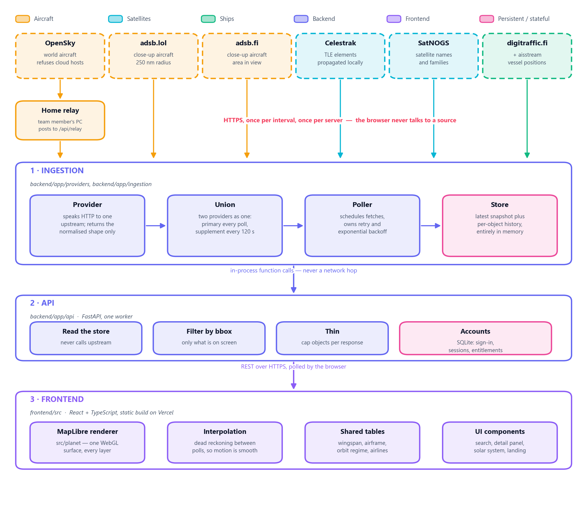
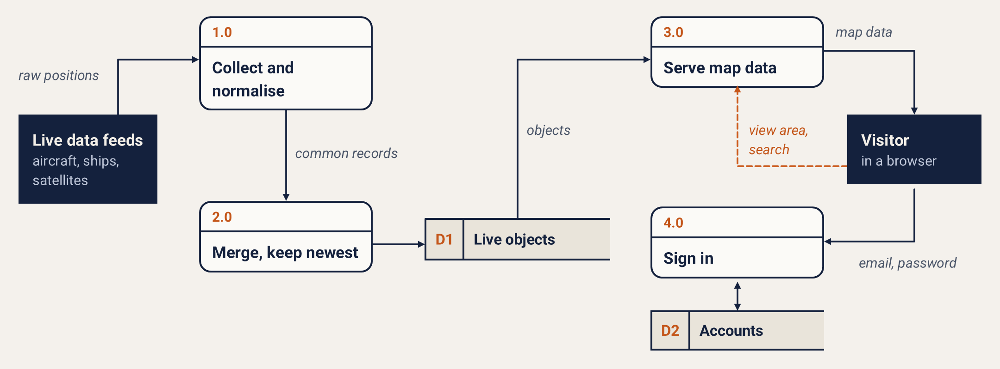
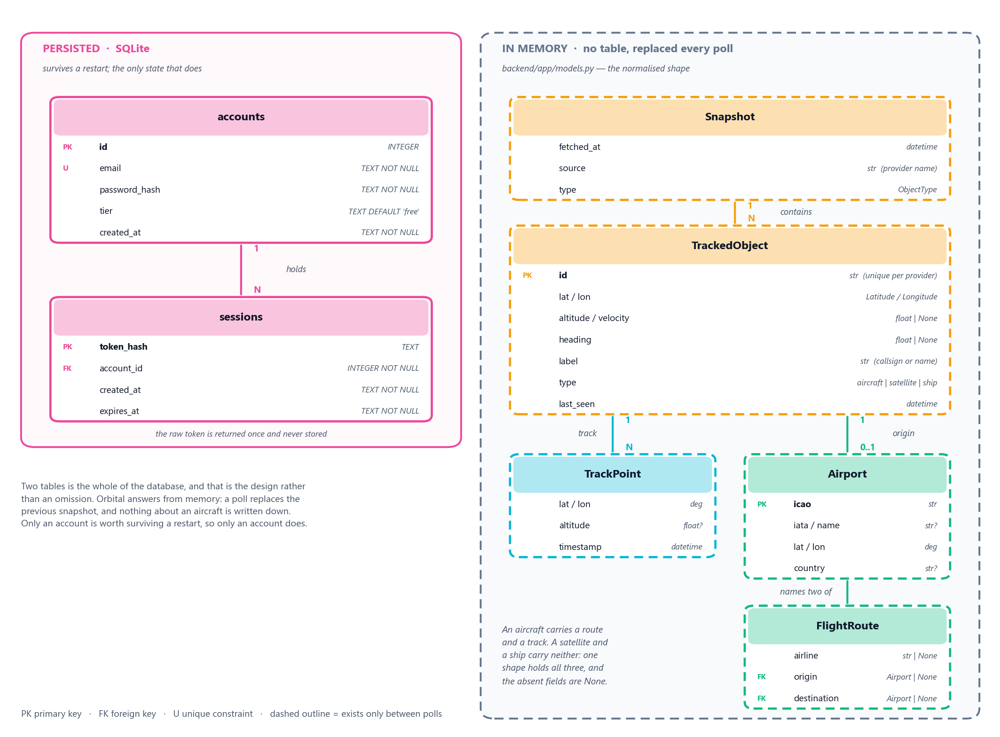
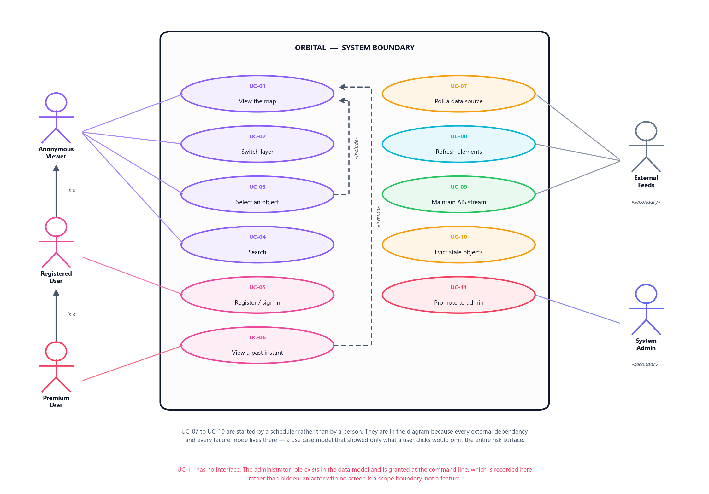
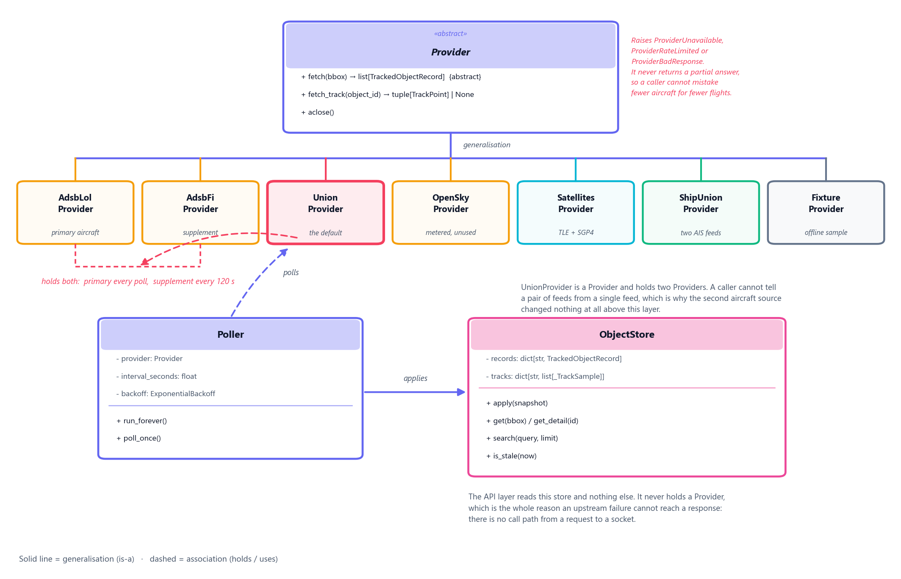
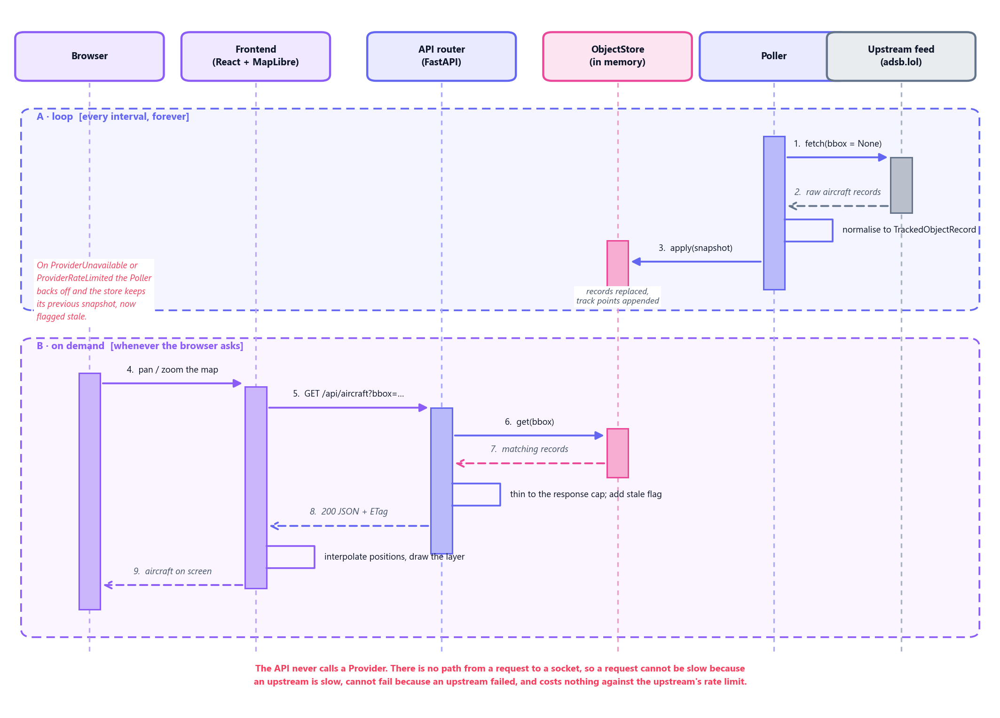
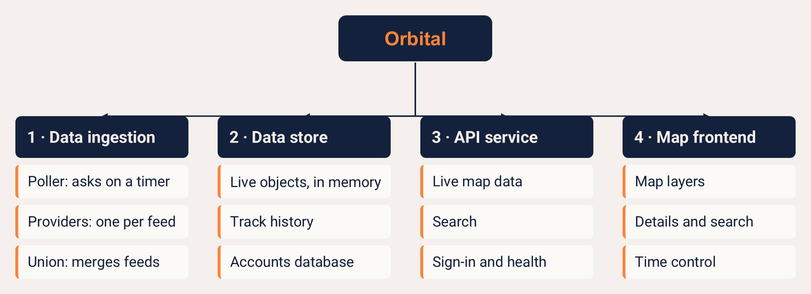

# Chapter 5: System Design

## 5.1 System Architecture

Orbital is three layers with one rule between them: **data flows in one
direction, and each layer knows only the layer directly beneath it.**

{width=6.5in}

### The three layers

| Layer | Owns | Never does |
|---|---|---|
| 1 Ingestion | Speaking to upstreams, normalising, scheduling, holding the current state | Know that a browser exists |
| 2 API | Reading the store, filtering by bounding box, thinning, accounts | Call an upstream |
| 3 Frontend | Rendering, interpolation, interaction | Know where the data came from |

### Three properties follow, and they are the design

**The browser never talks to a data source.** Every external call goes through
the backend, so rate limiting and caching are enforced in exactly one place. A
hundred open browser tabs cost the same upstream quota as one. This is what made
adding a second aircraft feed a backend-only change: the frontend was never
told, because there was nothing to tell it.

**Either end can be replaced without touching the other**, and both have been.
The backend gained a second upstream and the frontend gained an entirely
different renderer, neither requiring a change on the other side of the wire.

**Upstream failure is contained at layer 1.** The API serves the last good
snapshot with an explicit staleness flag. A feed outage degrades the display; it
does not break it.

### Deployment

| Component | Host | Shape |
|---|---|---|
| Frontend | Vercel | Static build, no server |
| Landing page | Vercel | `/landing`, the same deployment, static files |
| Backend | Northflank | One container, **one worker** |
| Accounts database | Northflank volume | SQLite file |
| OpenSky relay | A team member's PC | Script kept running by a Windows task, on mains or battery |

**One worker, deliberately.** The backend holds a websocket open to the AIS
stream, polls on a schedule, and answers every request from memory. A second
worker would open a second AIS socket, run its own poller and keep its own
store: the upstream cost would double and two requests could disagree about
where an aircraft is. It is scaled by making the box bigger, not by adding
boxes.

**The relay exists because OpenSky refuses cloud hosts.** It answers a home
connection, so a small script on a team member's PC does the fetching. Every
three seconds it asks the server what it wants, and the server answers with two
things:

| Request | Relay does | Cost |
|---|---|---|
| Someone is watching, and two minutes have passed | Fetches the world (about 5,500 aircraft) and posts it, gzipped, about 220 KB | 4 credits |
| A visitor clicked an aircraft | Fetches that aircraft's flown track and posts it | 4 credits |

Both addresses on the server need a shared secret, and are switched off without
one. With the PC off, the map falls back to adsb.fi for the area in view and to
the trail the server observed itself, which is now kept for four hours.

### The numbers that shape it

| Parameter | Value | Why that value |
|---|---|---|
| Objects per response | 2,000 | The cap above which the browser cannot draw a frame in budget |
| Object retention | 300 s | Longer than the longest poll interval, so a missed poll never drops an aircraft |
| Union supplement interval | 120 s | The metered feed answers once per interval regardless of the free feed's cadence |
| Aircraft request rate | 4 per minute | A fifth under the measured limit of burst-4 then ~5 per minute |
| Vessel ceiling | 14,000 | Bounds memory for a feed that accumulates rather than answers |

### Data flow diagram, Level 1

{width=6.5in}

| Process | Takes in | Gives out |
|---|---|---|
| 1.0 Collect and normalise | Raw positions from the live feeds | Common records |
| 2.0 Merge, keep newest | Common records | The newest position of each object, written to D1 |
| 3.0 Serve map data | The visitor's view area or search, and objects from D1 | Map data for that area only |
| 4.0 Sign in | Email and password | A session, checked against D2 |

D1, the live objects, is held in memory and rebuilt from the feeds after a
restart. D2, the accounts, is the one store saved to disk. Process 3.0 only
reads D1 and never calls a feed, so the map never waits for an outside service.

## 5.2 Software Design

### 5.2.1 Database Design

{width=6.5in}

#### Two tables, and that is the design

The persisted schema is `accounts` and `sessions`. Nothing else in Orbital is
written down.

```sql
CREATE TABLE accounts (
    id            INTEGER PRIMARY KEY AUTOINCREMENT,
    email         TEXT    NOT NULL UNIQUE,
    password_hash TEXT    NOT NULL,
    tier          TEXT    NOT NULL DEFAULT 'free',
    created_at    TEXT    NOT NULL
);

CREATE TABLE sessions (
    token_hash TEXT    PRIMARY KEY,
    account_id INTEGER NOT NULL,
    created_at TEXT    NOT NULL,
    expires_at TEXT    NOT NULL
);
CREATE INDEX sessions_account ON sessions (account_id);
```

An account holds many sessions: one per signed-in device, each expiring on its
own schedule.

**The raw session token is returned once, at creation, and never stored.** Only
its hash is in the table, so the token exists in the user's cookie and nowhere
else. A copy of the database does not let anyone sign in as anybody.

#### Why almost nothing is persisted

A tracker looks like a system that should have a large database, and Orbital
deliberately does not. A poll replaces the previous snapshot; positions are held
in memory and served from there; an object not re-observed within the retention
window is evicted. Nothing about an aircraft is written to disk at all.

Three consequences, and all three are wanted:

- **The API cannot be slow because a database is slow**, because there is no
  database on the request path for tracked objects.
- **There is no schema migration** for the thing that changes most often — the
  shape of a feed — because a feed's shape is normalised at the boundary and
  never stored in its own form.
- **Restarting is cheap and safe.** The only state worth keeping is an account,
  and that is the only state kept.

The cost is equally plain: Orbital cannot answer a question about last Tuesday.
Entitlement windows of twenty-four hours and seven days are bounded by what is
still in memory, not by a query.

#### The entities that have no table

`TrackedObject` is the shared shape all three object types normalise to, with
`TrackPoint`, `Airport` and `FlightRoute` hanging off it. They have real
structure, real relationships and real cardinality — they simply have no rows.
They are drawn dashed in Figure 5.3 because omitting them would make the data
model look like two tables about sign-in, which is the least interesting part of
this system.

**One shape holds all three object types, and the absent fields are `None`.** An
aircraft has a route and a track; a satellite and a ship have neither. This is
what makes a new object type cost one ingestion module: there is no per-type
schema to add.

### 5.2.2 UML Modeling

#### 5.2.2.1 Use Case Diagram

{width=6.5in}

UC-03 includes UC-01. UC-06 extends UC-01 when an instant is chosen, if that
instant lies within the actor's entitlement window. UC-07 to UC-10 are started
by a scheduler rather than a person, and are shown because every external
dependency and failure mode lives there.

**Use case descriptions**

**UC-01 View the map**

**Actor** Anonymous Viewer. **Preconditions** None; no account required.

1. The system draws the Earth on satellite imagery.
2. The client requests the active layer's objects for the visible area.
3. The API returns the cached snapshot, filtered and thinned, with its age.
4. The client draws each object oriented to its heading, coloured by the
   property that varies on that layer.
5. Between polls the client interpolates positions.

**A1** Data is stale: the response is flagged, markers past two minutes fade.
**A2** Backend unreachable: the last state remains; the map is not cleared.
**A3** More objects than the cap: a spatially even sample is returned and both
figures are reported.

**UC-02 Switch layer**

**Actor** Anonymous Viewer.

1. The viewer selects Aircraft, Satellites or Ships.
2. The system clears the current selection and objects.
3. All surrounding text changes with the layer — subtitle, search placeholder,
   count noun and colour key.
4. Layer-specific furniture is hidden; airports and receiver coverage belong to
   the aircraft layer.
5. The client polls the new layer's endpoint.

**UC-03 Select an object**

**Actor** Anonymous Viewer. **Includes** UC-01.

1. The viewer clicks a marker.
2. The client requests that object's full record.
3. A panel opens with fields appropriate to the layer.
4. The object's observed track is drawn.

**A1** Empty map clicked: the selection clears. **A2** No longer tracked: a 404
is returned and the panel says so rather than showing an empty record.

**UC-04 Search**

**Actor** Anonymous Viewer.

1. The viewer types into the search box.
2. After a debounce, the client requests results.
3. Matches are returned in separate groups, ranked within each but not across
   them, because they are not comparable.
4. Only the groups the active layer can act on are shown.
5. Choosing a result moves the camera to it and selects it.

**UC-05 Register and sign in**

**Actor** Anonymous Viewer becoming Registered User.

1. The viewer supplies an email and password.
2. A password shorter than ten characters is rejected.
3. The password is hashed with scrypt.
4. A session cookie is issued, HttpOnly and SameSite.

**A1** Email already registered: reported without revealing the password.
**A2** Wrong credentials: one message for both cases, so the response does not
disclose which accounts exist.

**UC-06 View a past instant**

**Actor** Registered or Premium User. **Extends** UC-01. **Precondition** Signed
in, satellite layer active.

1. The user moves the time control to a past instant.
2. The system checks it against the account's window: 24 hours free, 7 days
   premium.
3. Positions are propagated to that instant and returned.

**A1** Outside the window: refused with the window that does apply.
**A2** Beyond seven days: refused for every tier, because propagation accuracy
degrades about a kilometre per day.

**UC-07 Poll a data source**

**Actor** Scheduler, with an external feed as secondary actor.

1. The scheduler waits the configured interval.
2. It checks the remaining quota and the rate gate; if either forbids, it skips.
3. The provider fetches and converts to the shared shape, discarding objects
   without a usable position and converting every "not available" encoding to an
   explicit absence.
4. The store merges the result.

**A1** Unreachable: the previous snapshot is retained and the next attempt is
delayed by an increasing backoff. **A2** Rate limited: the upstream's own retry
hint is used. **A3** Both sources of a layer fail: only then is it an outage.

**UC-08 Refresh orbital elements**

1. Every six hours elements are fetched from CelesTrak.
2. Sets older than seven days from epoch are refused.
3. Accepted elements are cached to disk.

**A1** CelesTrak unavailable: SatNOGS is used. If both fail, cached elements
continue to serve.

**UC-09 Maintain the global AIS stream**

1. A WebSocket is opened and subscribed to the whole world.
2. Positions and identities are accumulated in memory.
3. Positions older than fifteen minutes are removed; identities are kept for six
   hours, because a vessel's name does not expire when its position does.

**A1** Connection dropped: reconnection with backoff, losing nothing, because
the accumulated world is held locally.

**UC-11 Promote an account to administrator**

**Actor** System Administrator at a terminal on the server.

1. The administrator runs the account tool on the host.
2. The tool sets the account's tier.

There is no interface for this and no endpoint that can perform it.

#### 5.2.2.2 Class Diagram

{width=6.5in}

The ingestion layer is the part of Orbital with real class structure, so it is
the part worth drawing. `Provider` is abstract and declares one required
operation: fetch, given an optional bounding box, and return the normalised
shape. Seven concrete providers implement it — one per upstream, plus an offline
fixture that needs no credentials.

**`UnionProvider` is the design point.** It inherits `Provider` *and holds two
of them*: the primary answers every poll, the supplement answers every 120
seconds, and the results are merged. A caller cannot tell a pair of feeds from a
single feed.

That is why the second aircraft source cost what it cost. When the primary
became unreachable from every cloud host, the change was one provider module and
one registry entry; the poller, the store, the API and the entire frontend were
untouched, because none of them can observe the difference.

`Provider` also raises rather than returning partial results —
`ProviderUnavailable`, `ProviderRateLimited`, `ProviderBadResponse`. A provider
that returned nine hundred aircraft instead of two thousand would be reporting
that the sky had emptied. Raising makes a failure a failure.

**The API never holds a `Provider`.** There is no call path from an HTTP request
to a socket, which is the structural reason §5.1's third property is true rather
than merely intended.

**Class relationships**

| Relationship | In Orbital |
|---|---|
| Inheritance | Every feed is a `Provider` (AdsbLol, AdsbFi, OpenSky, Satellites), so the poller treats them all the same way |
| Composition | `UnionProvider` owns its feeds: they are created with it and closed with it |
| Aggregation | A `Poller` has an `ObjectStore`, but the store outlives it and the API shares it |
| Association | The API uses the `ObjectStore` to answer requests and never touches a feed |

#### 5.2.2.3 Sequence Diagram

{width=6.5in}

Two interactions are drawn on one page deliberately. Separately they look like
an ordinary background job and an ordinary request; together, the actual design
is visible — **they never touch.**

**A.** The poller wakes on its interval, asks the provider to fetch, normalises
what comes back, and applies it to the store. This runs whether or not anyone is
looking.

**B.** The browser pans the map and asks for a bounding box. The API reads the
store, filters, thins to the response cap, adds the staleness flag, and answers.
The frontend interpolates positions between polls so that motion is smooth at a
far lower request rate than smooth motion would otherwise need.

The browser's request does not trigger a fetch, does not wait for one, and
cannot fail because one failed. It reads whatever the store last had. That single
property is why an upstream outage degrades Orbital rather than breaking it, and
why viewer count is decoupled from upstream cost entirely.

## 5.3 Structure Chart

{width=6.5in}

The structure chart breaks Orbital into four modules, matching the layers
above with the store drawn as its own module. Each module calls only the one
beside it, so a change inside one leaves the others untouched.

| Module | Made of |
|---|---|
| 1 Data ingestion | The poller, which asks on a timer; one provider per feed; the union provider, which merges feeds |
| 2 Data store | Live objects held in memory; track history; the accounts database |
| 3 API service | Live map data; search; sign-in and health |
| 4 Map frontend | Map layers; details and search; time control |
