# Chapter 7: GUI and Description

These are the key screens of Orbital, captured from the live site
(orbital-liveview.vercel.app) on 25 November 2026. The aircraft, ships and
satellites in them are real and were in those positions when captured. Each
screenshot is followed by what the screen is for and how it works. The
"Sponsored" cards are the free tier's advertising; premium removes them.

## 7.1 Interface Layout

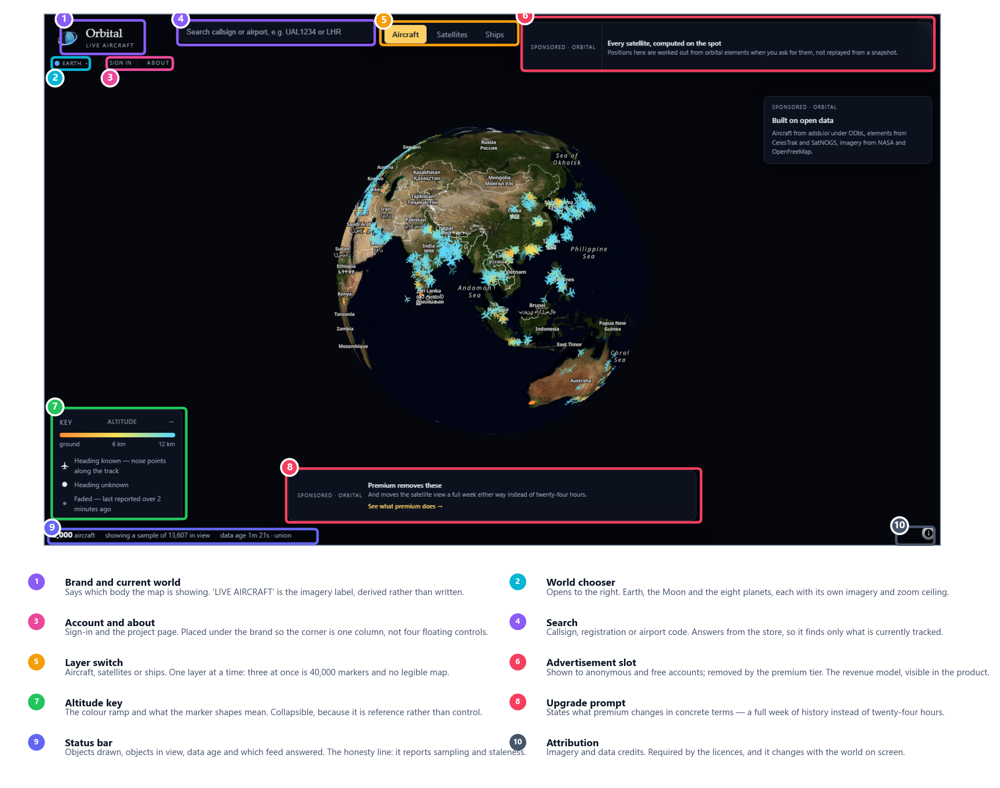{width=6.5in}

This is a screenshot of the running system rather than a wireframe. The counts
in the status bar — objects drawn, objects in view, data age, and which feed
answered — are the real ones at the moment of capture.

### The principles the layout follows

**The map is the product; everything else is chrome at the edges.** Controls
occupy the corners and the top strip. Nothing floats over the centre, because
the centre is the thing the user came for.

**One layer at a time.** Aircraft, satellites and ships are a switch rather than
three checkboxes. All three at once is roughly forty thousand markers and no
legible map; the switch makes that impossible rather than merely discouraged.

**The corner is one column, not four floating controls.** Brand, world chooser,
sign-in and about stack under one another, and the world chooser opens to the
right rather than downward so it does not cover the items beneath it.

**The status bar is the honesty line.** It states that 2,000 of 13,607 objects
in view are drawn, how old the data is, and which feed answered. A tracker that
quietly showed a sample as though it were everything would be easier to build
and would be lying.

**Colour carries meaning, and only meaning.** Altitude is a ramp; marker shape
distinguishes a known heading from an unknown one; a faded marker has not been
reported for over two minutes. The key states all three rather than expecting
the reader to infer them.

**The revenue model is visible in the product.** Advertisement slots are shown to
anonymous and free accounts and removed by the premium tier, and the upgrade
prompt says what premium changes in concrete terms — a full week of history
instead of twenty-four hours — rather than in adjectives.

## 7.2 Live Aircraft

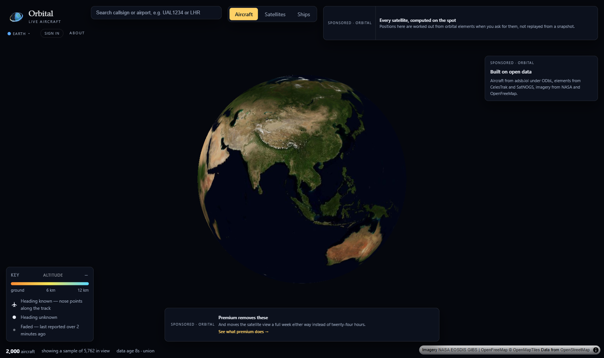{width=6.5in}

**Purpose.** The opening screen. It shows every aircraft the system currently
knows about, worldwide, on a 3D globe, so a visitor sees air traffic at a
glance without signing in.

**How it works.** The browser asks the Orbital API for the aircraft inside the
part of the globe on screen. The API reads them from the server's in-memory
store, which the OpenSky relay refreshes every two minutes and adsb.lol and
adsb.fi supplement. When more than 2,000 are in view, the API returns a sample,
and the status bar at the bottom says so ("showing a sample of 5,842 in view")
along with the data's age and source. Colour is altitude, explained in the key.

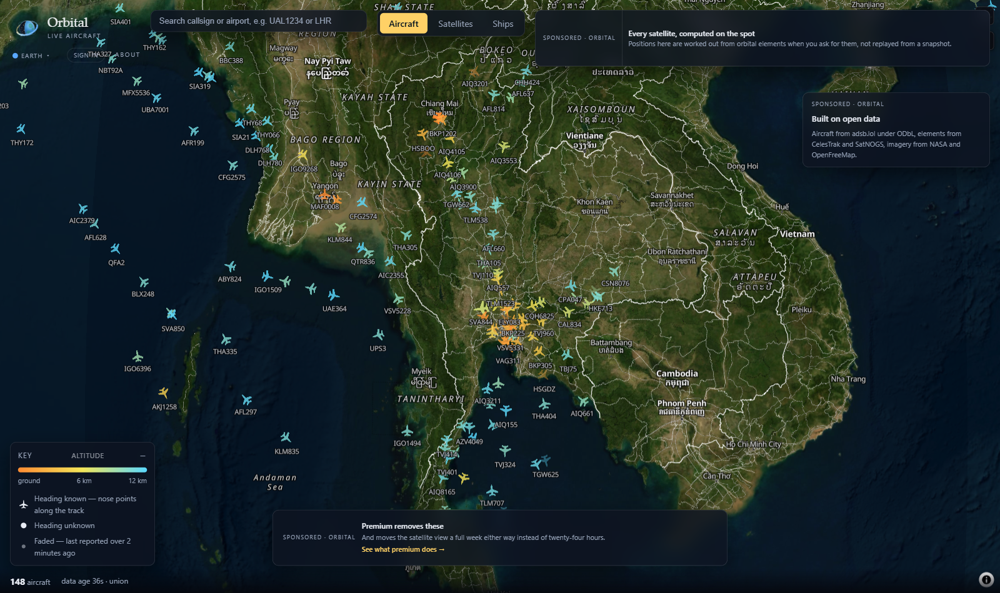{width=6.5in}

**Purpose.** Following traffic in one region with callsigns readable.

**How it works.** Scrolling zooms the map from the globe to street level in one
continuous view. As the visible area shrinks, the browser asks again for just
that area, so every aircraft in it is drawn instead of a sample. Each icon
points along its heading, is labelled with its callsign, and moves smoothly
between updates by dead reckoning along its last known heading and speed.

## 7.3 Search

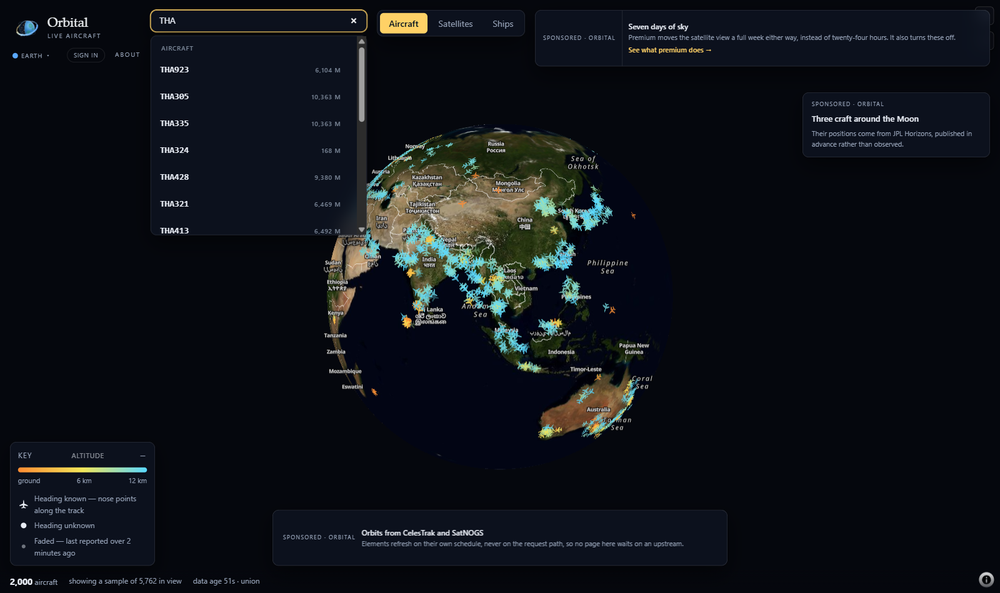{width=6.5in}

**Purpose.** Finding a particular flight, airport, satellite or ship without
looking for it on the map.

**How it works.** As the visitor types, the browser sends the text to the
search endpoint, which matches it against the objects held in memory and
returns up to eight suggestions with their altitude. Choosing one, or pressing
Enter, selects that object, flies the camera to it and opens its detail panel.
The search box searches whichever layer is active, and its placeholder text
changes to say what it accepts.

## 7.4 Aircraft Details and Flown Route

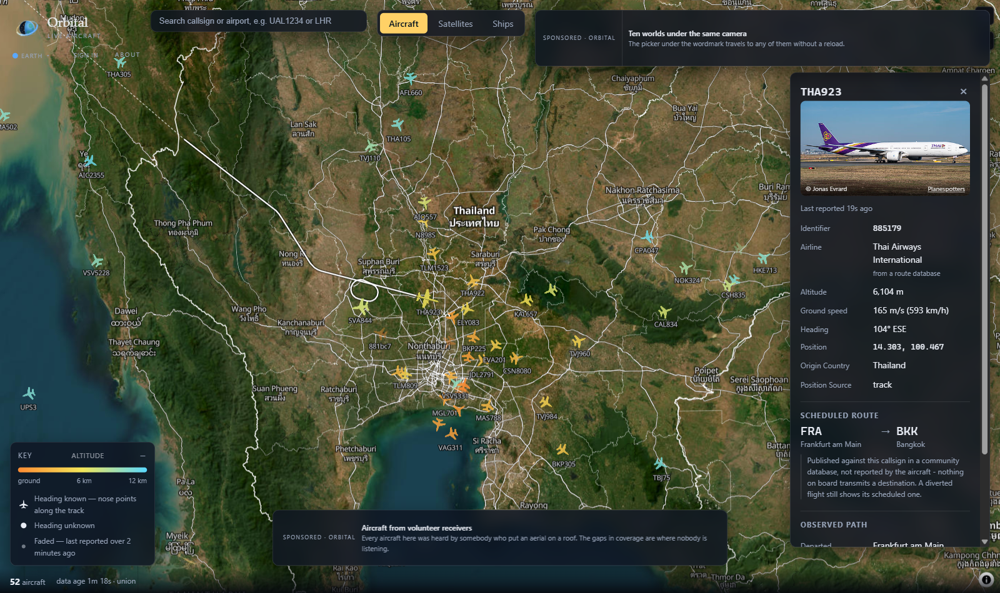{width=6.5in}

**Purpose.** Everything known about one aircraft: its photo, airline, aircraft
type, registration, altitude, speed and heading, its scheduled route, and the
path it has actually flown.

**How it works.** Selecting an aircraft asks the API for its details. The
server looks up the airline and aircraft type from shared tables and the
scheduled route from a community route database. It asks the home relay for
the aircraft's flown track from OpenSky, which arrives within a few seconds
and is drawn as the white line. The photo comes from Planespotters and is
credited to its photographer. The panel labels the scheduled route as
published rather than reported, because aircraft do not transmit their
destination.

## 7.5 Satellites

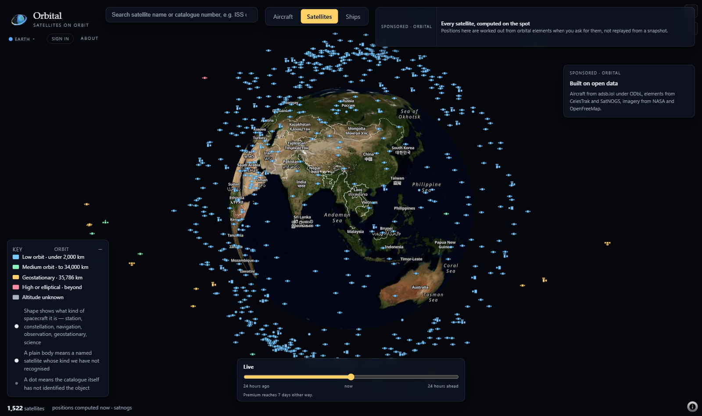{width=6.5in}

**Purpose.** Showing where active satellites are right now, and what kind of
orbit each is on.

**How it works.** Satellite positions are not downloaded; they are computed.
The server holds the published orbital elements for each satellite, refreshed
every six hours, and calculates each position with the SGP4 model when the
browser asks. Colour shows the orbit class (low, medium, geostationary or
elliptical), and the icon's shape shows what kind of spacecraft it is, as the
key explains.

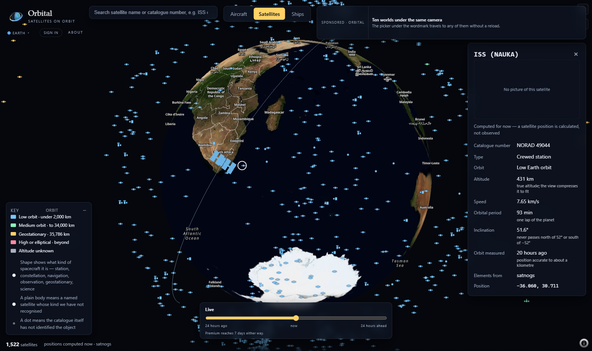{width=6.5in}

**Purpose.** Details of one satellite: its catalogue number, type, altitude,
speed, orbital period and inclination, and the orbit it follows.

**How it works.** Selecting a satellite computes its path for one full orbit
and draws it as a line around the globe. The panel says the position is
"computed for now", not observed, and how old the orbital elements are,
because accuracy falls as they age. Plain-language notes explain each value,
for example that an inclination of 51.6° means the station never passes north
of 52° or south of −52°.

## 7.6 Time Control

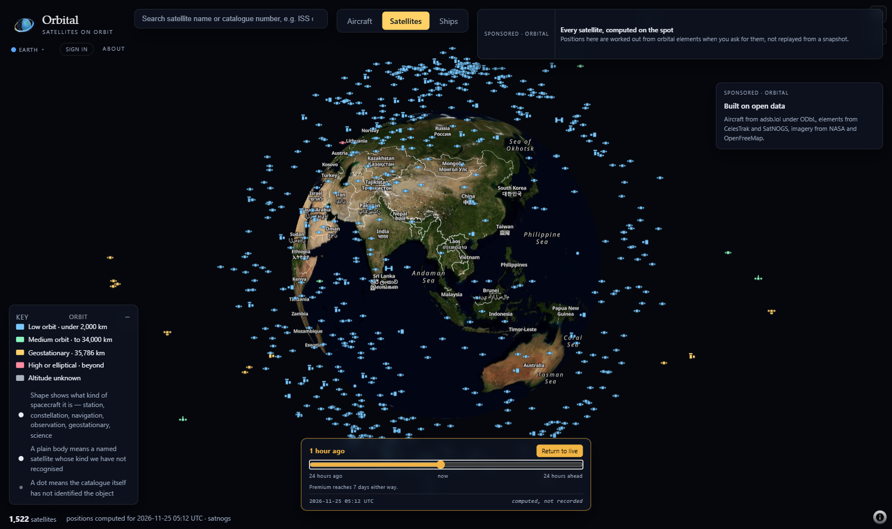{width=6.5in}

**Purpose.** Seeing where the satellites were, or will be, at another moment.

**How it works.** Because satellite positions are computed, they can be
computed for any time. Dragging the slider, or using the arrow keys, sends the
chosen time with each request, and every satellite is recalculated for that
moment. The panel turns amber, shows the exact time in UTC, and offers "Return
to live". Free users can move 24 hours either way and premium users 7 days.

## 7.7 Ships

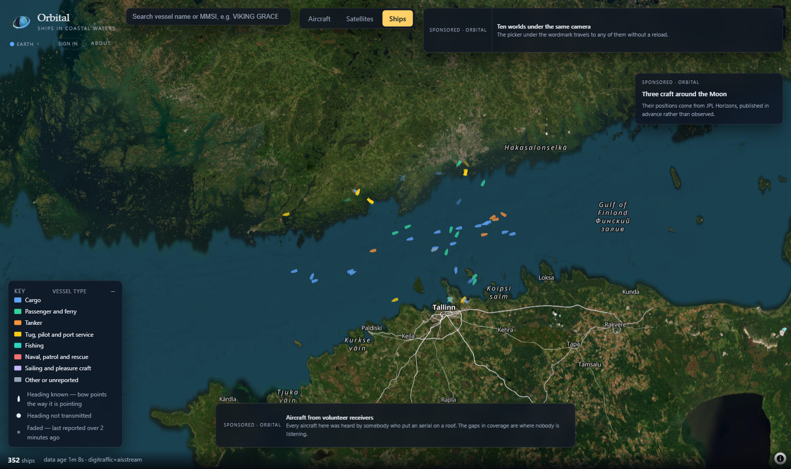{width=6.5in}

**Purpose.** Showing vessels near the coast, by type: cargo, passenger, tanker,
tug, fishing and others.

**How it works.** Ship positions come from AIS, merged from two sources: the
Finnish Digitraffic service and the global aisstream.io feed, which pushes
updates to the server over a WebSocket. Both are received by stations on the
shore, which is why the layer is labelled "ships in coastal waters" and is
densest around Finland.

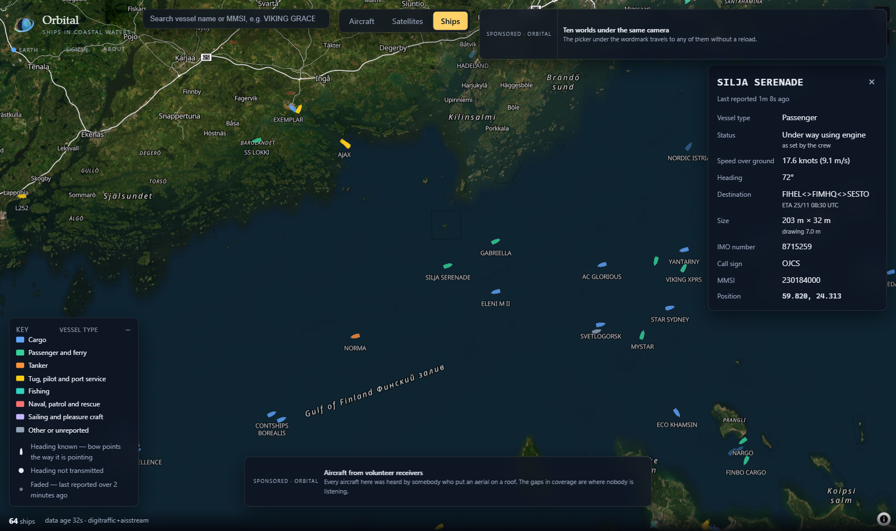{width=6.5in}

**Purpose.** Details of one vessel: its type, navigational status, speed,
heading, destination and arrival time, size, and identifying numbers.

**How it works.** Name, type, size and destination are broadcast separately
from position, and less often, so the server keeps adding them to a vessel's
record as they arrive. Values a transmitter marks as "not available" are never
shown as numbers, and the status is labelled "as set by the crew" because it
is entered by hand on board.

## 7.8 The Moon

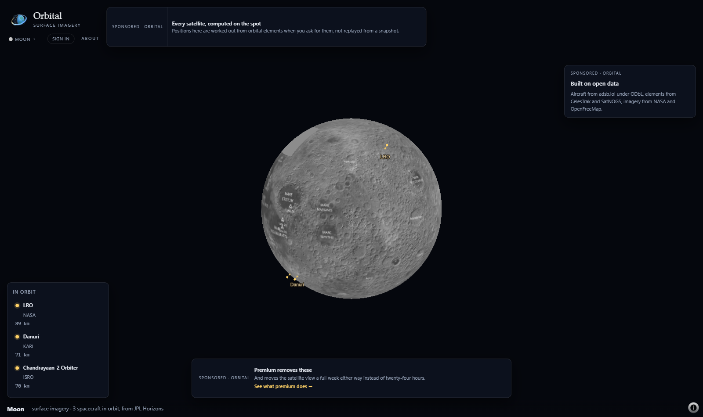{width=6.5in}

**Purpose.** Visiting other worlds under the same camera, and following the
spacecraft that orbit the Moon.

**How it works.** The world picker under the logo lists the Sun, the planets
and the Moon. Choosing one flies the camera out and back in, and swaps the
surface imagery. On the Moon, the "In orbit" panel lists LRO, Danuri and
Chandrayaan-2, whose positions come from NASA JPL's Horizons service and are
drawn over the surface.

## 7.9 The Solar System

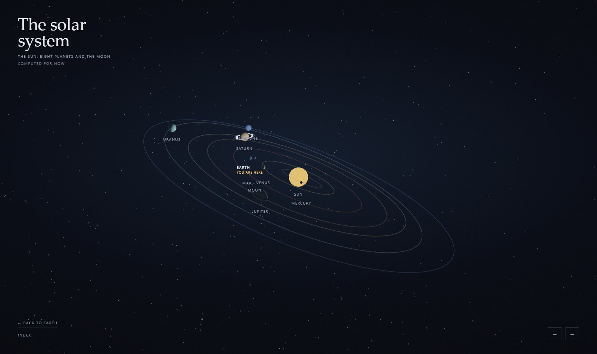{width=6.5in}

**Purpose.** An overview of the Sun, the eight planets and the Moon, as a way
to choose a world and to see where Earth is.

**How it works.** The planets' positions are computed for the current date
from their orbits and drawn on their orbital paths. Earth is marked "you are
here". The arrows and the index move between bodies, and "Back to Earth"
returns to the map.

## 7.10 Accounts and Premium

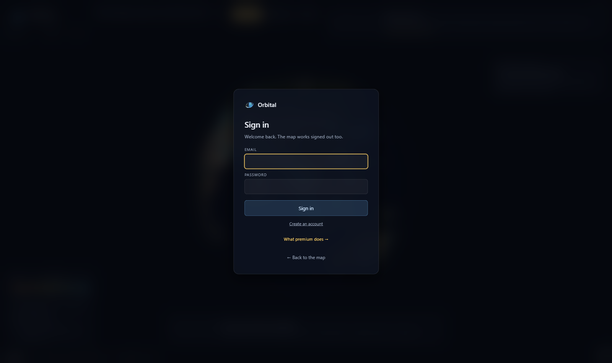{width=6.5in}

**Purpose.** Signing in to an existing account or creating a new one. The map
works without an account; an account is needed only for premium.

**How it works.** The email and password are sent to the API over HTTPS. The
server checks the password against a scrypt hash stored in its SQLite
database, and on success sets a session cookie that scripts on the page cannot
read. Passwords are never stored, logged or returned.

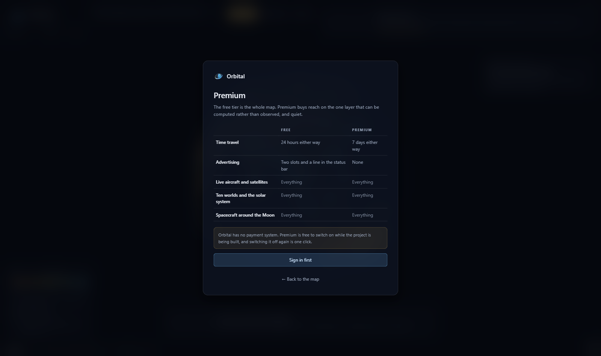{width=6.5in}

**Purpose.** Explaining what premium adds: time travel 7 days either way
instead of 24 hours, and no advertising. Everything else is free.

**How it works.** The page reads the visitor's tier from their session. Orbital
has no payment system, so a signed-in user switches premium on or off with one
click, and the server records the tier on their account. The time control and
the advertising read that tier and change at once.
